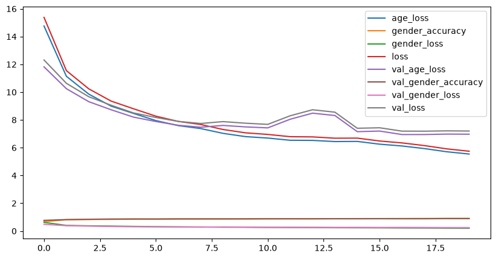

# 🧑 Age & Gender Estimator

**Live demo:** [agegenderestimator.streamlit.app](https://agegenderestimator.streamlit.app/)

## Problem Statement
Estimating a person's age and gender from a face photo is hard because people of the same age can look very different, and the same face can look older or younger depending on lighting and photo quality. I built one model that looks at a face photo and predicts both the age (in years) and the gender (male or female).

## Executive Summary
I used the UTKFace dataset of cropped face images. The images were resized to 64×64, scaled to 0–1 and fed to a CNN with two outputs: one for age (regression) and one for gender (binary classification). The labels are read directly from the file names. The data was split into train, validation and test sets, stratified by gender and age so each set has the same male/female mix.

The final model reached an average age error of about **6.8 years** and **89.2% gender accuracy** on unseen test images. I deployed it in a Streamlit app where the user takes or uploads a face photo and sees the estimated age and predicted gender with its confidence.

## Table of Contents
```
Age_Gender_Prediction/
├── README.md
├── Code/            # python file with data prep, training and evaluation
│    └── age_gender_model.py
└── app/             # Streamlit app, trained model, requirements.txt
│    ├── requirements.txt
│    ├── age_gender_app.py
│    └── age_gender_model.keras
│
└── images/
     └── model_performance.png
```

## Data
**Source:** UTKFace: about 23,000 cropped face images with ages from 0 to 116.

**Labels:** taken from each file name, which follows the pattern `[age]_[gender]_[race]_[date].jpg`. Only age and gender are used (gender: 0 = male, 1 = female).

**Input:** one face image resized to 64×64 RGB. **Output:** an age in years and a probability of female; above 0.5 is predicted as female.

## Results
| Model | Age error (MAE) | Gender accuracy |
|---|---|---|
| CNN (2 conv blocks, one dense layer ,2 outputs), test set | 6.8 years | 89.2% |

Training curves of age error and gender accuracy are in the Code folder and as shown below.

## Conclusions and Recommendations
- One shared CNN predicts both age and gender, which keeps the model small and fast.
- Gender is predicted well (88.5%), while age is harder: predictions are off by about 9 years on average.
- The model works best on clear, colored, front-facing, tightly cropped faces similar to the training images.
- The model was not checked for race, so results may be less accurate for groups that are less represented in UTKFace.
- To improve it: train on race to classify the images better.

## Further Research
- Compare age error across racial groups and rebalance the training data if needed.
- Predict age groups instead of exact years.

## Sources
- UTKFace dataset
- Streamlit documentation
