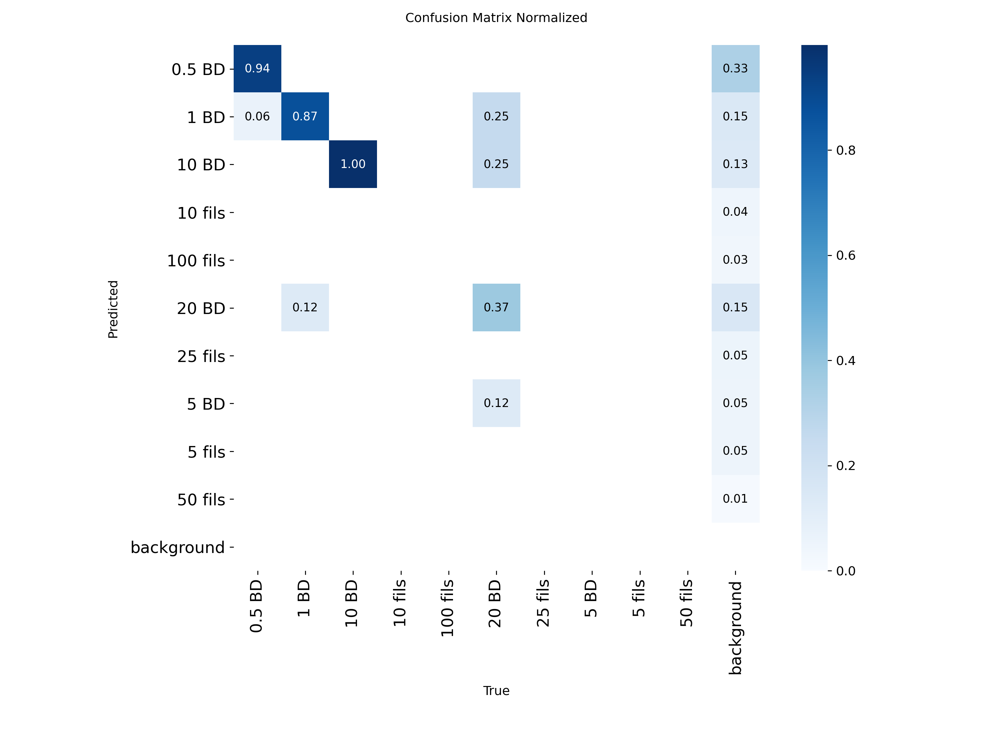
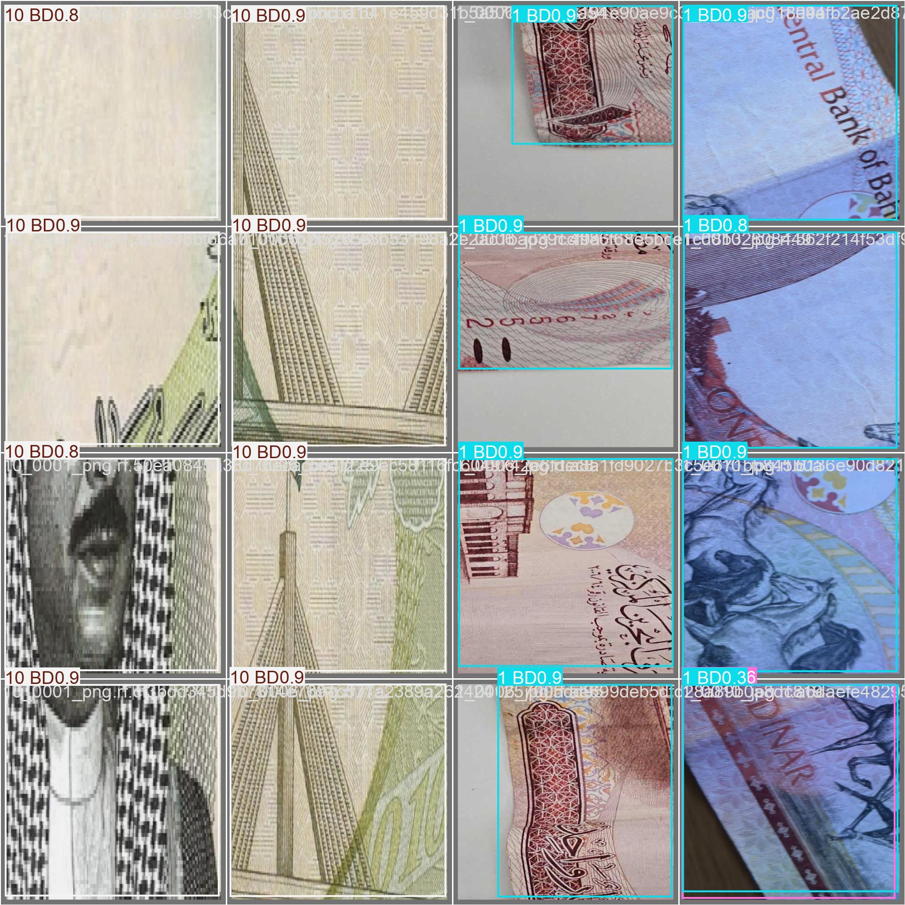

# 💵 Bahraini Currency Detector

**Live demo:** [bahrainicurrencydetector.streamlit.app](https://bahrainicurrencydetector.streamlit.app)

* * *

## Problem Statement

Telling Bahraini banknotes and coins apart is easy for most people but hard for visitors, new residents, people with low vision, and anyone handling cash quickly. Notes of different denominations share similar colors and designs, and mistakes at the counter cost time and money. We built an object detection model that finds each banknote or coin in a photo or a live camera feed and labels its denomination, so the user gets an instant, clear answer.

* * *

## Executive Summary

I used the public **bahraini-currency** dataset on Roboflow Universe (version 2), which contains annotated images of Bahraini currency with a bounding box and a denomination label for every note or coin. The data was exported in YOLO format and split into train, validation and test sets. Data augmentation was applied in Roboflow.

The task is **object detection**, so the model has to both locate each note and classify it. I fine-tuned a pretrained **YOLO (`yolo26s`)** model from Ultralytics on the dataset for 10 epochs at an image size of [640] pixels. i evaluated it on the held-out test set with precision, recall, mAP, a confusion matrix, and a per-class and error analysis. On unseen images the model reached a precision of **0.73**, a recall of **0.83**. The model works the best with 10 and 1 bd, and worst with fills.

I deployed the model in a **Streamlit app** with two modes: a **live camera** mode that streams the visitor's own camera through the model in real time (using `streamlit-webrtc`), and an **upload photo** mode that detects currency in an image. Both draw the detected boxes and labels on the image.

* * *

## Table of Contents

```
Bahraini_Currency_Detector/
├── README.md
├── app/                           # deployed Streamlit app
│   ├── currency_clf_detector.py   # the Streamlit app
│   ├── best.pt                    # trained YOLO weights used by the app
│   └── requirements.txt
├── Code/                          # training and evaluation notebook
│   └── bahraini_currency_classification_datection.py
└── images/                        # images
```

* * *

## Data and Data Dictionary

**Source:** the [bahraini-currency (v2) dataset](https://universe.roboflow.com/noora-alkhalaqi/bahraini-currency-2-hnw2l) on Roboflow Universe, published by Noora Alkhalaqi.

**Format:** YOLO. Each image has a matching `.txt` label file with one line per object: `class x_center y_center width height`, with all values normalized between 0 and 1.

| Item                | Value                                                    |
|---------------------|----------------------------------------------------------|
| Task                | Object detection (bounding box + class)                  |
| Total images        | 405                                                      |
| Train / Val / Test  | 4608 / 44 / 40                                           |
| Image size          | 512x512                                                  |
| Augmentation        | Rotation: Between -15° and +15° , Blur: Up to 2.5px , Motion Blur: Length 100px, Angle: 0°, Frames: 1 , Camera Gain: Variance: 0.05|

### Classes

| ID  | Class name   | Description                          |
|-----|--------------|--------------------------------------|
| 0   | [0.5 BD]     | [Half-dinar note]                    |
| 1   | [1 BD]       | [One-dinar note]                     |
| 2   | [5 BD]       | [Five-dinar note]                    |
| 3   | [10 BD]      | [Ten-dinar note]                     |
| 4   | [20 BD]      | [Twenty-dinar note]                  |


### Model and app files

| File                       | Description                                                       |
|----------------------------|-------------------------------------------------------------------|
| `best.pt`                  | Best weights from training (YOLO `yolo26s`, fine-tuned)           |
| `currency_clf_detector.py` | Streamlit app: live camera and photo upload modes                 |
| `requirements.txt`         | Python packages needed to run the app (CPU-only PyTorch)          |

* * *

## Key Visualizations

**Confusion matrix on the test set:**



the model seperates the bds well but not the fills.

**Example detections:**




* * *

## Model Evaluation

| Metric         | Test result |
|----------------|-------------|
| Precision      | 0.73        |
| Recall         | 0.83        |
| mAP50          | 0.866       |
| mAP50-95       | 0.848       |

**Per-class performance:**

| Class  | Precision | Recall | AP50 |
|------- |----------|--------|-------|
| 0.5 BD | 0.853    | 1.000  | 0.988 |
| 1 BD   | 0.718    | 0.957  | 0.962 |
| 10 BD  | 0.784    | 1.000  | 0.967 |
| 20 BD  | 0.571    | 0.375  | 0.548 |


* * *

**Note:** the live camera mode needs the browser's camera permission and runs on CPU when deployed, so the video can be slower than on a local machine with a GPU.

* * *

## Conclusions and Recommendations

**Conclusions**

- A fine-tuned YOLO model detects and classifies Bahraini currency with a precision of 0.73 and a recall of 0.83 on unseen images.
- 20 bhd and 5 bhd are detected reliably, while 5 ,10,25,50,100 fills are confused most often, mainly because they look alike.
- Fine-tuning from pretrained weights worked well even with a small dataset, but the number and variety of images per class limits how well the model generalizes.

**Recommendations**

- Add more photos for the weakest classes, taken in different lighting, backgrounds, angles, and with folded or worn notes.
- Set a confidence threshold in practical use, and show "not sure" instead of a wrong answer.
- Train for more epochs and compare a larger or smaller YOLO model for the best balance of accuracy and speed.

* * *

## Areas for Further Research

- **Coins and older note series:** extend the classes to all coins and to previous designs of each note.
- **Total value:** add up the detected notes and coins and show the total amount.
- **Accessibility:** add spoken output so visually impaired users can hear the denomination.
- **Counterfeit detection:** a different and harder problem that needs security-feature data, and this model does not address it.
- **Speed:** export the model to ONNX or TFLite for faster on-device or mobile inference.
- **Live video:** improve frame rate on the deployed app with a smaller image size or a lighter model.

* * *

## Sources

- Alkhalaqi, N., [bahraini-currency (v2) dataset](https://universe.roboflow.com/noora-alkhalaqi/bahraini-currency-2-hnw2l), Roboflow Universe.
- [Ultralytics YOLO documentation](https://docs.ultralytics.com).
- [Roboflow documentation](https://docs.roboflow.com).
- [Streamlit documentation](https://docs.streamlit.io) and [Streamlit Community Cloud](https://streamlit.io/cloud).
- [streamlit-webrtc](https://github.com/whitphx/streamlit-webrtc).
- [Central Bank of Bahrain](https://www.cbb.gov.bh), for the currency denominations and designs.
