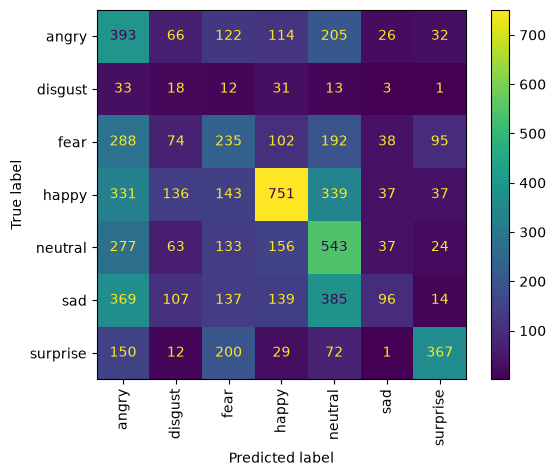

# 😊 Facial Emotions Classifier

**Live demo:** [emotionsclassifier2.streamlit.app](https://emotionsclassifier2.streamlit.app/)

---

## Problem Statement

Reading emotions from faces automatically is hard because faces vary and some emotions look alike. I built a model that looks at a face photo and predicts one of 7 emotions: angry, disgust, fear, happy, neutral, sad or surprise.

---

## Executive Summary

I used the FER-2013 dataset of 48×48 grayscale face images. The images were scaled to 0–1 and fed to a CNN model. The data is imbalanced (happy is the largest class, disgust the smallest), so I looked at per-class results and not only overall accuracy.

The final model reached **33% accuracy** on unseen test images. It works best on **surprise** and struggles most with **disgust**. I deployed it in a Streamlit app where the user uploads a face image and sees the predicted emotion with its confidence.

---

## Table of Contents

```
Emotions_Classifier/
├── README.md
├── Code/            # python file with data prep, training and evaluation
├    └── emotions_model2.py 
└── app/             # Streamlit app, trained model, requirements.txt
    └── requirements.txt
    └── streamlit_camera2.py
    └── emotion_model2.keras
```

---

## Data

**Source:** [FER-2013](https://www.kaggle.com/datasets/msambare/fer2013) on Kaggle: about 35,900 grayscale 48×48 face images in `train/` and `test/` folders, one sub-folder per emotion.

**Classes:** `angry`, `disgust`, `fear`, `happy`, `neutral`, `sad`, `surprise`

**Input:** one face image. **Output:** a probability for each emotion; the highest is the prediction.

---

## Results

| Model | Train accuracy | Test accuracy |
|---|---|---|
| [Baseline] | 20% | 20% |
| **[Final model]** | 30% | **33%** |



---

## Conclusions and Recommendations

- **CNN** model was chosen for the app because it had the best test accuracy (30%).
- Small classes such as disgust and fear are the hardest to predict.
- Use better network, or add more layers
---

## Further Research

- Fine-tune a larger pre-trained model.

---

## Sources

- [FER-2013 dataset](https://www.kaggle.com/datasets/msambare/fer2013), Kaggle.
- [Streamlit documentation](https://docs.streamlit.io)

